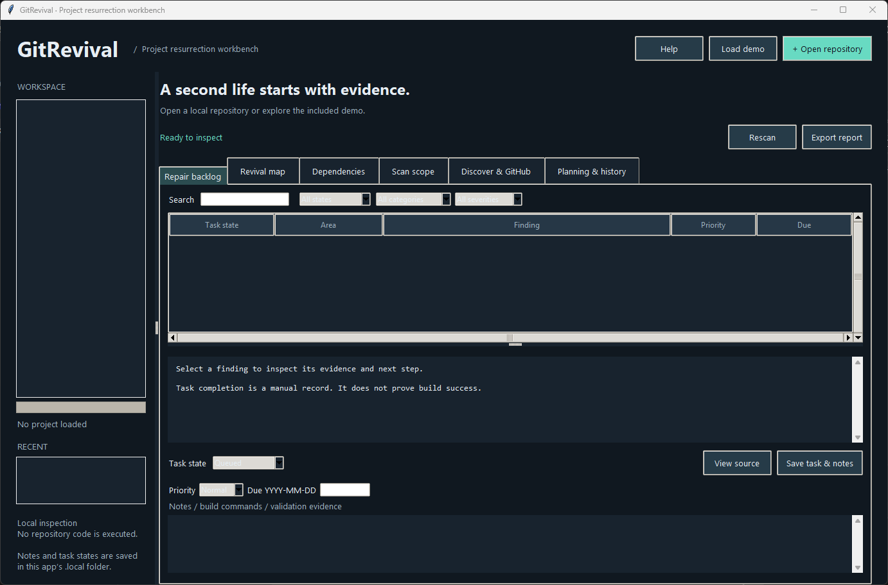
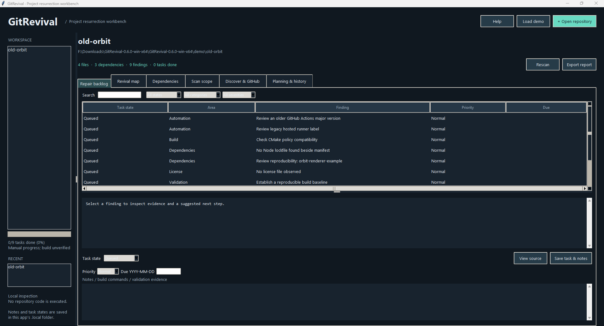
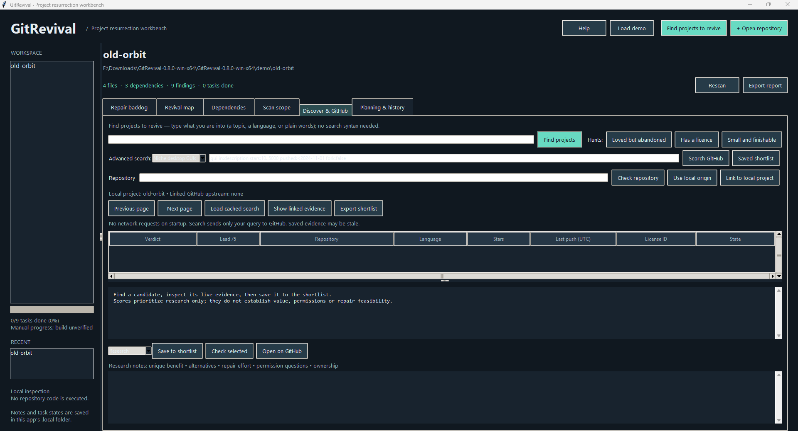

# GitRevival

A local desktop workbench for bringing old software projects back to life.

## TL;DR

Think of GitRevival as a careful mechanic's inspection for an old car you found in a barn. You point it at a folder containing an old software project. It walks around the project, takes notes about what looks worn out or missing, and hands you a checklist — with the reason for every item on it. It never starts the engine: nothing in the project is run. You work through the checklist, tick items off, and keep your notes in the program. It can also scout GitHub for other forgotten projects worth rescuing.

**Version 0.6.0 — dependency edges with source navigation, and license-text checks, on top of 0.5.0's headless workspace operations, 0.4.0's catch-up (tooltips, autosave, session restore, built-in guide) and 0.3.0's planning, scan history, backups and headless inspection.** Python 3.11+ with Tcl/Tk is required. No third-party Python packages or connected accounts are required. Tested on Windows with Python 3.15 and Tk 9.0; other platforms are not yet validated.

## Windows portable download

The [0.8.0 release](https://github.com/SeanShaffer88/GitRevival/releases/tag/v0.8.0) supplies `GitRevival-0.8.0-win-x64.zip` with isolated CPython 3.15.1/Tcl-Tk, validated on Windows Server 2022 and 2025 (see the release's validation report). Extract into a writable folder and run **Start GitRevival.bat**; no installed Python is required. To update, close the app, back up `.local`, then copy that folder into the new app folder. Source ZIPs retain the Python 3.11+ requirement below. Runtime notices and per-file hashes accompany the portable ZIP.

## Screenshots

Real captures from the 0.8.0 portable build running on Windows:



*The main window on first run — open a repository, load the demo, or pick a recent project.*



*The bundled `old-orbit` demo scanned: 4 files, 3 declared dependencies, 9 findings in the repair backlog.*



*Finding projects to revive: plain words in, a plain verdict on every result out.*

## Start

On Windows, double-click **Start GitRevival.bat** or **launch.pyw**. Alternatively, open a terminal in this folder and run:

```powershell
python -m gitrevival.app
# Optionally open a repository immediately:
python -m gitrevival.app "C:\path\to\repository"
```

Choose **Load demo** to inspect a deliberately incomplete synthetic project. Choose **Open repository** to inspect your own local checkout. Local inspection makes no network requests. **Discover & GitHub** offers explicit read-only network actions; no cloning occurs.

## Workflow

1. Inspect a repository. Review **Scan scope** for exclusions and warnings.
2. Browse the **Repair backlog**. Each finding includes evidence, source location, confidence, and a suggested next step.
3. Use **Revival map** to navigate inspection areas. **Dependencies** lists directly declared dependencies extracted by supported parsers.
4. Set tasks to Queued, In progress, Blocked, Done or Dismissed. Add build commands, test evidence and decisions to notes; notes save on their own as you type, and **Save task & notes** or Ctrl+S saves right away.
5. Rescan after changes. Unchanged finding IDs retain task state and notes. Previously recorded findings remain in older exports; the current view shows current scan findings.
6. Export Markdown or JSON for working with a coding assistant or preparing a revival plan. Exports include local paths, manifest snippets and notes; review them before sharing.

Projects and notes are stored in `.local/workspace.sqlite3` beside the application. Back up that folder to retain your workspace; source packages exclude it. Keep the app in a writable folder. Notes are plain local SQLite data, not encrypted. Identical folder names can appear separately in the project list; the selected repository's full path appears above the tabs.

## Revival potential, living forks and CI bitrot (0.8.0)

A live **Check** now gathers the evidence that separates dead weight
from a viable revival: **unmet demand** (open issues versus issues
closed in the last 24 months), the **last known healthy state** (the
most recent completed GitHub Actions run and whether it passed), and
**living forks** — the top forks by stars, with an ahead/behind
comparison whenever a fork has pushed more recently than the original,
so a community continuation is spotted before anyone starts over.
Licenses carry a plain permissiveness label (Permissive, Weak copyleft,
Copyleft, No licence identified). The local scan flags more CI bitrot:
old and first-generation GitHub Actions, retired runner labels,
AppVeyor, and CircleCI 1.0 configurations. Future feature ideas live in
[docs/ROADMAP.md](docs/ROADMAP.md).

## Finding projects to revive (0.7.0)

Discovery is the front door: the header's **Find projects to revive**
button jumps straight to it. Type plain words — a topic, a language, or
both, like `photo editor python` — and GitRevival builds the GitHub
search for you (the built search stays visible and editable below, as
the advanced search). Ready-made hunts cover the common intents:
**Loved but abandoned** (well-starred, quiet for two years), **Has a
licence** (quiet projects where GitHub reports a licence), and **Small
and finishable** (small, quiet codebases). Every result gets a plain
verdict — **Strong candidate**, **Worth a look**, or **Long shot** —
with the reasons in everyday words, both in the results list and at the
top of the evidence view. Verdicts are research leads built from the
same signals as the detailed evidence; they never judge value, safety,
or permission to reuse.

## Dependency edges, source navigation and license checks (0.6.0)

- **Internal dependency edges.** The scan resolves imports *between files in the same project* — Python `import` / `from` (absolute and relative) and JavaScript/TypeScript relative `import` / `require` — into an edge list shown on the Dependencies tab and included in every report and export. External packages are not edges; unresolved imports are simply not listed. The list is capped at 2,000 edges with a scope warning.
- **Source navigation.** Double-click an edge, or select a finding and choose **View source**, to open a read-only viewer of that file inside the inspected project with the exact line marked. Nothing is edited or executed.
- **License-text checks.** License files are matched by distinctive phrases against MIT, BSD-2-Clause, BSD-3-Clause, Apache-2.0, GPL-2.0/3.0, LGPL-2.1/3.0, AGPL-3.0, MPL-2.0, ISC and the Unlicense. Advisories flag text that matches nothing known, copyleft terms to review, and any mismatch between the license declared in `package.json` / `pyproject.toml` / `Cargo.toml` and the text actually present. A match is a research lead, never a legal determination.
- Headless: `python -m gitrevival.cli deps <repository>` prints the edges and license detections as JSON.

## Rehabilitation workbench (0.9.0)

1. **PR Graveyard + contributor outreach:** a repository Check also surfaces long-untouched open pull requests that already carry approvals, and names the top non-owner contributors — the people and patches a revival starts from.
2. **Maintainability profile:** the local scan reports god files, test-harness presence, recorded coverage, documentation depth and funding signals, all from recorded evidence (the suite is never run).
3. **Online dependency audit:** the **Dependency audit (online)** button — or `python -m gitrevival.cli audit <repository>` — checks declared dependencies against their package registries and GitHub's advisory database, and reports whether revival names (`-ng`, `2`, `-rs`) are available on the registry.
4. **Kickstart drafts:** the **Kickstart drafts** button — or `python -m gitrevival.cli kickstart <repository> --output <folder>` — writes an ADOPTERS.md banner, a maintainer outreach letter, a CI modernization checklist and an issue backlink draft into a folder you choose. You review and use them yourself; GitRevival never posts or pushes.
5. **Headless discovery:** `python -m gitrevival.cli discover audio editor --hunt loved --min-stars 100 --inactive-months 18-36` prints one JSON object per repository (NDJSON), ready for scripts and scheduled runs.
6. **Git recovery (advanced, 0.10.0):** the last tab inspects the open project's .git data for dangling commits — amended, rebased or reset-away work — with reflog and index state, and can rebuild one chosen commit's files into a folder you pick (never overwriting, never writing into the repository). Headless: `git-scan` and `git-recover`.

## Headless workspace operations (0.5.0)

Everything in this section runs without opening the window and without any network request, against the same workspace database (the two deliberate exceptions are the online commands `audit` and `discover` described above, which run only when invoked) the window uses (`--workspace PATH` selects a different one; list commands print JSON to standard output; file outputs must be new files; errors exit with code 2):

```powershell
python -m gitrevival.cli projects                                   # list saved projects
python -m gitrevival.cli export "C:\path\to\repository" --output report.md   # fresh inspection + report with saved task states
python -m gitrevival.cli backup --output workspace-backup.sqlite3   # checked backup; an existing file is refused
python -m gitrevival.cli scans "C:\path\to\repository"              # list the project's saved scan snapshots
python -m gitrevival.cli diff-scans "C:\path\to\repository" 3 7 --output changes.json  # compare two snapshots (exit 1 = differences)
python -m gitrevival.cli shortlist --output shortlist.md            # export the saved revival shortlist
```

Project arguments accept a saved project's folder path or its name. `export` saves the fresh scan into the workspace, exactly as opening it in the window would. Backlog editing, custom tasks and the GitHub discovery actions remain window-only; `docs/PARITY.md` is the exact record of what each surface offers.

## Catch-up improvements (0.4.0)

1. **Tooltips everywhere:** every button, list, table and input in the window explains itself in plain words when you rest the pointer on it.
2. **Autosave:** task notes and candidate research notes save on their own shortly after you stop typing; the workspace database now uses SQLite's write-ahead log, so a sudden stop is far less likely to lose or lock your work. Ctrl+S still saves immediately.
3. **Pick up where you left off:** the window reopens at its previous size and position, with your last project and tab restored, and a Recent list in the sidebar reopens a recent project in one click.
4. **Built-in guide:** the **Help** button (or F1) opens a plain-words guide to the whole workflow inside the program. It works offline; the separate shortcut list is unchanged.
5. **Project paperwork:** `PROJECT_RULES.md`, `QUALITY.md` and `docs/PARITY.md` now record the project's rules, its evidence-based quality scores, and which capabilities the window and the command line each offer.

## Planning and review improvements (0.3.0)

1. **Severity filter:** limit the backlog to Review or Info findings alongside existing search/state/category filters.
2. **Dependency search:** search extracted names, constraints, ecosystems and manifest paths.
3. **Sortable columns:** click any table heading to sort; click again to reverse. Numeric values sort numerically; version constraints sort as text when nonnumeric. Refreshing a table restores its default order.
4. **Completion progress:** the workspace sidebar shows Done/total tasks, including custom tasks. Dismissed tasks remain in the denominator. This records manual planning progress, not build success.
5. **Task priorities:** Low, Normal, High and Urgent are saved with notes and shown as sortable backlog columns.
6. **Due dates:** optional, validated YYYY-MM-DD calendar dates appear in the backlog and exports. Dates do not create reminders or background activity.
7. **Custom repair tasks:** Planning & history → Add custom task records a title and acceptance criteria. These are labeled Manual/Custom, persist across rescans and can be dismissed using the existing task states.
8. **Task change history:** select a task, then Planning & history → Task history. Each save records state, notes, priority, due date and UTC time. The newest 100 saves are displayed; older events remain in the workspace. History starts with this version.
9. **Scan snapshots:** the latest 20 static scans per project are retained. Existing projects gain their previous saved scan during automatic additive migration.
10. **Finding differences:** select exactly two scan snapshots to see added, removed, evidence-changed and unchanged findings. Comparison uses stable IDs and inspection fields. Removed findings may reflect exclusions, parsing changes or incomplete scans; they do not prove a repair. Snapshots do not contain historical task states.
11. **Workspace backups:** Planning & history → Back up workspace creates a new SQLite file using SQLite's consistent backup API and checks its integrity. Existing files are refused. To restore, close GitRevival, preserve the current workspace separately, then copy the backup to `.local/workspace.sqlite3`. Backups include local paths, notes and cached GitHub metadata; keep them private.
12. **CSV backlog exports:** Export report now offers CSV with states, priorities, dates, evidence and notes. Formula-like cells receive an apostrophe prefix for spreadsheet safety. Markdown/JSON also include priority and due dates.
13. **Headless inspection:** run the bounded static scanner without importing Tk, opening the workspace or contacting GitHub:

    ```powershell
    python -m gitrevival.cli inspect "C:\path\to\repository" --output scan.json
    ```

14. **Headless report comparison:** compare two GitRevival JSON reports (20 MB input limit each):

    ```powershell
    python -m gitrevival.cli compare before.json after.json --output changes.json
    ```

    CLI outputs must be new files. Inspection returns 0 on a completed bounded scan (review scope warnings); comparison returns 0 for no finding differences, 1 for differences, and either command returns 2 for errors. These codes do not verify a build.
15. **Keyboard review:** Ctrl+F focuses backlog search, F5 rescans, F1 opens the built-in guide; Ctrl+O and Ctrl+S remain available.

## Inspection coverage

- Node package declarations, lockfile presence and scripts.
- Python project dependencies, Poetry dependencies, requirements and interpreter constraints.
- Basic Cargo dependencies, Go module requirements and vcpkg manifests.
- CMake package declarations and minimum-version policy review.
- MSBuild/NuGet package references, .NET targets and Visual C++ toolsets.
- License-file discovery, missing README, Git submodule content and selected older GitHub Actions/runner patterns.

Local inspection is **static inspection**, not dependency resolution. It does not prove a dependency is broken, query vulnerabilities, evaluate license compatibility, or run builds. The optional discovery view retrieves dated GitHub maintenance signals separately. Older declarations are review leads, not automatic failure verdicts. Task completion is a manual record and never a build-success claim.

The map groups findings by inspection area; it is not a transitive dependency graph. Parsers do not evaluate CMake, MSBuild properties, YAML, Python code, workspace/target Cargo tables, optional Python dependency groups or build conditions. Git metadata is excluded from the local scanner; the optional **Use local origin** action reads an ordinary `.git/config` without executing Git or loading included config files. For worktrees, paste the upstream manually.

Reads are limited to selected text files: 15,000 inventoried files, 512 KB per inspected file, 12 MB total inspected text. Generated/vendor folders, virtual environments, symlinks and reparse directories are excluded. Scanning a live mutable tree is best effort; use a stable checkout for consistent results. Do not treat inspection as a sandbox or scan hostile files with elevated privileges.

## Discover promising revival candidates

Open **Discover & GitHub** without opening a local repository. The simple route is the plain-words find and the ready-made hunts at the top (0.7.0). For finer control, choose a preset and click **Search GitHub**, or edit the GitHub repository search query directly. Presets include niche desktop GUIs, Windows tools, C++ libraries, Python tools and archived projects. The default GUI search looks for descriptions containing `gui`, 10–5,000 stars, no pushes for roughly two years, and non-forks; these are editable research filters, not abandonment claims. Archived repositories remain eligible.

Search pages contain up to 25 results. GitHub supplies pages sorted by stars; GitRevival orders each fetched page by its research-priority score. **Previous page** and **Next page** access up to GitHub's first 1,000 matches. Narrow the query for larger searches. Truncated results reported by GitHub are labeled. Search indexing and push dates do not establish maintenance status or whether a project needs revival.

Select a result to see timestamped metadata and the rationale for its **0–5 research-priority score**:

- 2 points when GitHub identifies a license other than `NOASSERTION`.
- 1 point for at least 25 stars, a weak historical-interest signal.
- 1 point when the last reported push is at least 730 days old.
- 1 point for declared topics, which provide clues about purpose.

This score is not a value, security, license compatibility or repair-feasibility assessment. A smaller or recently updated project may be a better choice. Assess unique benefit, maintained alternatives, fork permission, repair effort, platform support, security and long-term ownership in research notes. Set a candidate to Research, Promising, Investigating, Reviving or Passed, then **Save to shortlist**. **Saved shortlist** reads local data without contacting GitHub. **Export shortlist** writes Markdown or JSON with evidence dates and your notes.

**Check repository** accepts `owner/repository`, an HTTPS GitHub repository URL, or a GitHub SSH-style origin. **Check selected** refreshes a chosen candidate. Each live check requests:

- Repository metadata: current canonical name, archive/disabled/fork flags, parent, stars, last push, default branch and GitHub's detected SPDX license ID.
- The latest published non-prerelease release, if available. A release endpoint 404 is recorded as no matching release, not proof that the project has never released anything.
- One default-branch commit sample.
- The first five most recently updated open issue/PR entries, filtering pull requests out of the displayed sample. The metadata count is explicitly **issues + pull requests**; the sample is not a complete issue inventory.

Partial failures are retained alongside successful metadata. A denied/rate-limited request stops the remaining checks, shows reset/retry information when supplied, and never automatically retries. Each request has a 12-second network timeout and a 2 MB response limit. Reads are restricted to `api.github.com`; redirects outside that host are refused. No repository code, workflow or install hook is run. There is no background polling or scheduled monitoring.

**Use local origin** fills the repository field from the current local project's origin. **Link to local project** associates the selected result with the open local project. **Show linked evidence** loads its saved snapshot; local report exports include that evidence with its retrieval timestamp. Linking is explicit because a local fork's origin may differ from its intended upstream.

Successful searches and check snapshots are stored in the existing `.local/workspace.sqlite3` database. **Load cached search** reads the exact query and page locally and labels the result cached. Saved results are never silently presented as refreshed. Refreshing a shortlisted repository preserves research notes/status, including canonical repository renames; existing 0.1 workspaces migrate automatically. These are latest snapshots, not a full evidence history.

### GitHub access

Public access works without signing in. GitHub documents a 60-request/hour unauthenticated core budget and a separate search budget; actual returned rate headers are displayed. One full repository check normally costs four core requests. These budgets can also be consumed by other clients sharing the same IP.

For optional authenticated access, provide `GITREVIVAL_GITHUB_TOKEN` in the process environment before launching. The app reads only this explicit variable; it does not discover Git credentials, request account connections, or save the token to SQLite, exports or source. Requests remain GET-only. Grant only the read access needed. The app can access repositories permitted by that token; avoid exporting private metadata or sensitive research notes publicly.

API data is evidence supplied by GitHub, not a complete audit of upstream health, license texts, advisories, transitive dependencies or platform compatibility. GitHub's license detection does not establish permission to distribute all code/assets or compatibility with your intended product.

Upstream API documentation checked 2026-10-22: [repository search](https://docs.github.com/en/rest/search/search#search-repositories), [repository metadata](https://docs.github.com/en/rest/repos/repos#get-a-repository), [rate limits](https://docs.github.com/en/rest/using-the-rest-api/rate-limits-for-the-rest-api). Live public search and all four repository-check request paths were exercised on that date. HTTP uses Python's standard library; no new package dependency was adopted.

## Troubleshooting

- **"GitRevival needs Python 3.11 or newer with Tcl/Tk support" (source version):** install Python from python.org with the Tcl/Tk option, or use the Windows portable download instead, which needs no installed Python.
- **The window opens but a project will not inspect:** choose a readable local folder (not a single file). The Scan scope tab and the footer explain exclusions and read limits after a successful scan.
- **GitHub search or check fails with a rate message:** the message shows when the limit resets. Wait for it, use **Load cached search** or your saved shortlist meanwhile, or set `GITREVIVAL_GITHUB_TOKEN` before launching for a higher personal limit. GitRevival never retries on its own.
- **Notes seem missing after a crash:** reopen the app — it restores your last project, and notes autosave as you type. If the workspace file itself is damaged, restore from a Planning & history backup as described in the built-in guide (Help / F1).
- **Screenshots:** the Screenshots section above carries real captures from the 0.6.0 portable build on Windows. Still owed from a real Windows run: the repair backlog with a finding open, the Dependencies tab with internal edges, the revival map, Discover & GitHub with results, and Planning & history. No placeholder images are used.

## Project structure

- `gitrevival/analyzer.py` — the bounded, read-only inspector.
- `gitrevival/store.py` — the SQLite workspace: projects, tasks, settings, snapshots, backups.
- `gitrevival/github.py` — read-only GitHub requests and lead scoring.
- `gitrevival/discovery.py` — the Discover & GitHub panel and shortlist.
- `gitrevival/planning.py` / `planning_data.py` — planning, history, snapshot comparison and exports.
- `gitrevival/app.py` — the main window; `gitrevival/cli.py` — headless inspection, comparison and workspace operations; `gitrevival/tooltips.py` — hover help for controls.
- `tests/` — the full test suite; `tools/` — the Windows portable packager and its checker; `demo/old-orbit` — the synthetic sample project.

## Development

```powershell
python -m unittest discover -s tests -v
```

GUI smoke tests create and close real Tk windows, including asynchronous discovery/search/check/save/link/export flows. Tests use temporary state and mocked HTTP responses for deterministic failure and rate-limit coverage. No project fixture is installed or executed.

Architecture: `analyzer.py` performs bounded read-only inspection; `store.py` saves task state, candidates and evidence snapshots; `github.py` provides read-only API requests and explainable lead signals; `discovery.py` implements candidate research; `app.py` owns the main UI. Inspection and HTTP requests run in worker threads. All Tk and SQLite work stays on the GUI thread. Closing the window cancels pending UI callbacks; HTTP workers are daemon threads and hold no database connection.

Future feature ideas — revival-potential depth, registry and community tooling, headless discovery — are recorded in [docs/ROADMAP.md](docs/ROADMAP.md).

## Next useful milestones

- Drag and drop a repository folder onto the window to open it.
- Baseline comparisons across saved snapshots in the window (snapshot differences are already available headless).
- More discovery signals and structured effort estimates validated against real revival work.
- Build-environment profiles and build-log capture only if running project code is ever approved as its own decision — the inspector's never-executes rule stands until then.

## Technology decision (2026-10-22)

Consulted the shared resource catalog's desktop SDK and language sections. Chose Python's standard-library Tkinter/ttk and SQLite: they support a local GUI and persistence without a package installation. Avalonia, Qt and Tauri remain candidates if richer native UI or executable packaging warrants additional dependencies. Confirmed local Tk 9.0.4 availability and checked the Python upstream documentation. No new catalog resource was discovered or added.

Sources: [Tkinter](https://docs.python.org/3/library/tkinter.html), [sqlite3](https://docs.python.org/3/library/sqlite3.html). Python and Tcl/Tk have their own upstream licenses; they are prerequisites and are not bundled in this source distribution.

Update (2026-10-31): the Python standard-library choice was re-audited against the project's current requirements and kept — zero third-party dependencies, a bounded workload, and a working portable bundle outweigh a rewrite. The reasoning and the current quality scores are recorded in `QUALITY.md` and `PROJECT_RULES.md`.

MIT licensed. The demo is an original synthetic fixture and is not a vendored upstream project.

### Windows packaging

`python tools/package_windows.py --python-root PATH_TO_CPYTHON_3_15_1 --output NEW_PARENT` packages tracked sources and an isolated local runtime. No user state or site packages are copied. `python tools/test_portable.py --package PATH --results NEW_JSON` checks hashes, relocates to spaces/Unicode, exercises Tk, runs the complete test suite and CLI, and launches the windowed app with only System32 on PATH. Runtime notices, source URLs and hashes are under `licenses/runtime`. Interpreter binaries are unmodified; omitted optional tooling is documented in PORTABLE.txt.
